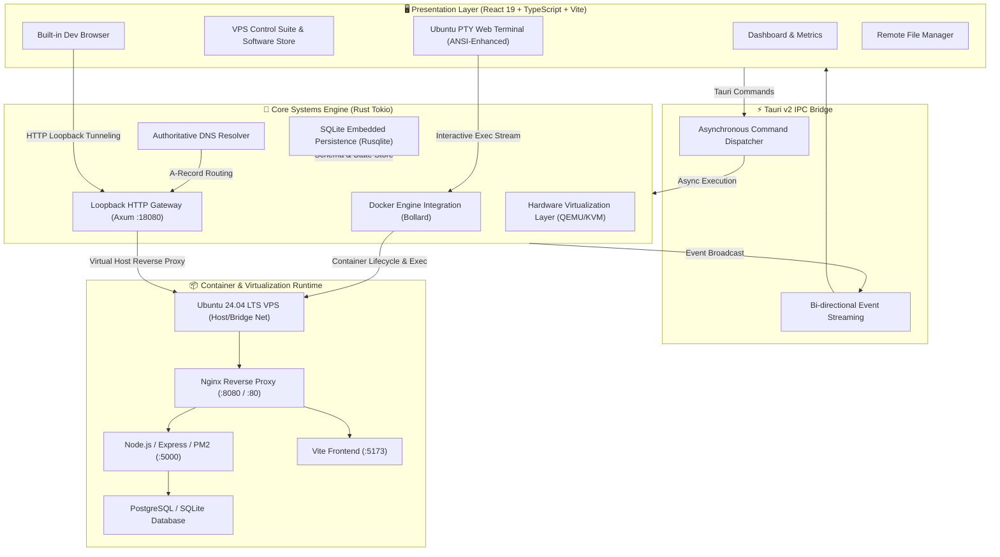

# ☁️ PocketCloud — Zero-Cost Private Cloud & Full VPS Sandbox on Your Desktop

[](https://tauri.app/)
[](https://www.rust-lang.org/)
[](https://react.dev/)
[](https://www.docker.com/)
[](https://ubuntu.com/)
[](https://opensource.org/licenses/MIT)

**PocketCloud** is an ultra-fast, lightweight, desktop-native cloud sandbox and DevOps laboratory built with **Tauri v2**, **Rust**, and **React 19**. It enables developers, DevOps engineers, and system architects to spin up full **Ubuntu 24.04 LTS VPS instances**, orchestrate isolated microservices, configure real reverse proxies and authoritative DNS networks, and inspect traffic—all locally on their workstations with zero cloud costs.

---

## 📥 Downloads & Releases (Latest: v0.1.2)

| Platform | Format | Direct Download Link | Size |
|---|---|---|---|
| **Windows 10 / 11** | **Setup Installer (.exe)** | [**PocketCloud-Setup-0.1.0.exe**](https://github.com/IamFreak10/PocketCloud/releases/download/v0.1.2/PocketCloud-Setup-0.1.0.exe) | 4.3 MB |
| **Windows 10 / 11** | **Portable Standalone (.exe)** | [**PocketCloud.exe**](https://github.com/IamFreak10/PocketCloud/releases/download/v0.1.2/PocketCloud.exe) | 8.4 MB |
| **Windows 10 / 11** | **MSI Package (.msi)** | [**PocketCloud-0.1.0.msi**](https://github.com/IamFreak10/PocketCloud/releases/download/v0.1.2/PocketCloud-0.1.0.msi) | 4.3 MB |
| **Linux (Ubuntu/Debian)** | **Debian Package (.deb)** | [**PocketCloud_0.1.0_amd64.deb**](https://github.com/IamFreak10/PocketCloud/releases/download/v0.1.2/PocketCloud_0.1.0_amd64.deb) | 4.8 MB |
| **Linux (Fedora/RHEL)** | **RPM Package (.rpm)** | [**PocketCloud-0.1.0-1.x86_64.rpm**](https://github.com/IamFreak10/PocketCloud/releases/download/v0.1.2/PocketCloud-0.1.0-1.x86_64.rpm) | 4.8 MB |

👉 **Full Installation & Usage Guide**: [**USER_GUIDE.md**](USER_GUIDE.md)

---

## 🏛️ System Architecture Overview

PocketCloud employs a decoupled, multi-tier reactive architecture that unifies systems-level Rust performance with modern web-based UI ergonomics.



---

## 🔬 Core Architectural Subsystems

### 1. 🦀 Core Systems Engine & Tauri IPC (`src-tauri/src/`)
- **Memory Safety & High Concurrency**: Implemented in Rust using `tokio` multi-threaded runtime.
- **Typed Command Dispatching** (`commands.rs`): Strongly typed IPC communication bridging React frontend actions directly to Linux kernel/Docker APIs.
- **State Management**: Concurrent thread-safe state wrappers (`Arc<RwLock<T>>`) managing active container handles, routing tables, and DNS state without lock contention.

### 2. 🐳 Container & VPS Runtime (`src-tauri/src/docker.rs`)
- **Direct Bollard Docker Engine**: Interacts with the local Docker daemon via UNIX domain sockets (`/var/run/docker.sock`).
- **Container Persistence**: Smart container reuse mechanism ensures that packages, software, and user files inside `/root` or `/home` persist seamlessly across app restarts without accidental destruction.
- **Dual Networking Topologies**:
  - **Host Network Mode (`--net=host`)**: Direct binding for low-latency networking, ideal for Full VPS simulations.
  - **Bridge Network Mode**: Isolated network namespace with explicit port forwarding (`host_port:target_port`).
- **Resource Constraints (cgroups)**: Fine-grained RAM (e.g. 512MB/1GB) and CPU quota enforcement via Linux cgroups.
- **Dynamic Hostname Injection**: Automatically populates `/etc/hosts` inside VPS containers to ensure clean name resolution (e.g., `127.0.0.1 ubuntu-24`).

### 3. 🌐 Loopback HTTP Gateway & Virtual Host Router (`src-tauri/src/gateway.rs`)
- **Embedded Axum Web Server**: Runs on `127.0.0.1:18080`.
- **Zero-Config Virtual Domain Routing**: Resolves `.test` synthetic domains (e.g., `http://web.test`, `http://myapi.test`, `http://shop.test`) and routes them dynamically to internal container ports without requiring modification of the host machine's `/etc/hosts`.
- **Port Fallback & Reverse Proxy Streaming**: Full HTTP request/response streaming with header forwarding (`Host`, `X-Forwarded-For`, `Upgrade`, `Connection`).

### 4. 🧭 Authoritative DNS Resolver (`src-tauri/src/dns.rs`)
- **Local In-Memory DNS Engine**: Supports standard `A`, `CNAME`, and `TXT` records for local domains.
- **Probing & Health Checking**: Async health probes verify whether target container ports are actively listening before returning routing responses.
- **NXDOMAIN Simulation**: Emulates realistic DNS failure states when unmapped domains are requested.

### 5. 💻 Authentic Ubuntu Web Terminal (`src/components/TerminalView.tsx`)
- **Canonical Aubergine Theme**: Styled to match native Ubuntu 24.04 Server terminal aesthetics (`#300a24` background, high-contrast monospace typography).
- **ANSI Escape Sequence Processing**: Implements standard ANSI terminal clears (`\x1b[2J\x1b[3J\x1b[H`), cursor repositioning, and prompt preservation.
- **Paste Normalization**: Handles complex multi-line pastes, CRLF cleanup, and buffer sanitization to prevent accidental command concatenation.
- **Signal & Interrupt Handling**: Real-time `Ctrl+C` interrupt signaling and `Ctrl+L` screen clearing.

### 6. 🌍 Integrated Dev-Browser (`src/components/BuiltinBrowserView.tsx`)
- **Seamless Local Web Navigation**: Internal WebView/Iframe capable of rendering both virtual domains (`http://web.test`) and port-explicit addresses (`http://localhost:5173`, `http://localhost:8080`).
- **Developer Inspection Toolbar**: Live URL bar, navigation controls (Back, Forward, Refresh, Copy URL), and live HTTP status telemetry.

### 7. 📦 VPS Control Suite & Software Store (`src/components/VpsManagerView.tsx`)
- **1-Click Software Marketplace**: Automated background provisioning scripts for:
  - **Nginx 1.24+** (Reverse Proxy & Static Web Server)
  - **Node.js LTS (v24.x) & npm**
  - **PM2 Process Manager**
  - **Python 3 & Pip**
  - **Docker-in-Docker / Podman**
  - **PostgreSQL / Redis**
- **Process Explorer**: Real-time monitoring of active container processes, CPU utilization, and memory consumption.
- **File Explorer**: Graphical remote file system navigation, directory traversal, file inspection, and editing.

### 8. 🗄️ Embedded SQLite State Engine (`src-tauri/src/db.rs`)
- Embedded SQLite storage with automatic schema migrations.
- Stores custom lab configurations, user preferences, domain records, and historical deployment logs.

---

## 📂 Codebase Directory Structure

```text
pocketcloud/
├── src/                               # Frontend Presentation Layer (React 19 + TypeScript)
│   ├── components/                    # UI Component Library
│   │   ├── BuiltinBrowserView.tsx     # In-app Web Browser with Gateway Tunneling
│   │   ├── Header.tsx                 # App Header & System Status Badges
│   │   ├── LabsView.tsx               # Lab Topology & Component Grid
│   │   ├── TerminalView.tsx           # ANSI Ubuntu 24.04 Web Terminal
│   │   └── VpsManagerView.tsx         # VPS Suite: Store, Files, Processes
│   ├── services/                      # Data Access & IPC Layer
│   │   └── api.ts                     # Strongly-typed Tauri Invocation Wrappers
│   ├── App.tsx                        # Master Application Layout & View Router
│   ├── types.ts                       # Shared TypeScript Interfaces & Data Models
│   └── main.tsx                       # React DOM Entrypoint & Theme Bootstrap
│
├── src-tauri/                         # Core Systems Engine (Rust + Tauri v2)
│   ├── src/
│   │   ├── capabilities.rs            # Security & App Sandbox Permissions
│   │   ├── commands.rs                # Tauri IPC Command Implementations
│   │   ├── db.rs                      # SQLite Database Layer & Migrations
│   │   ├── dns.rs                     # Local Authoritative DNS Engine
│   │   ├── docker.rs                  # Docker Engine API Integration (Bollard)
│   │   ├── gateway.rs                 # Loopback Reverse Proxy & .test Routing
│   │   ├── lib.rs                     # Tauri Application Builder & Plugin Registration
│   │   ├── qemu.rs                    # Hardware Virtualization Abstraction
│   │   └── tests.rs                   # Systems & Integration Test Suite
│   ├── Cargo.toml                     # Rust Crates & Build Dependencies
│   └── tauri.conf.json                # Tauri v2 Desktop Configuration
│
├── docs/                              # Project Documentation & Architecture Guides
│   └── UBUNTU_VIRTUAL_SETUP_GUIDE.md  # Comprehensive VPS Setup & Deployment Guide
├── PROJECT_STATUS.md                  # Development Roadmap & Release Milestones
├── DEBUGGING_LOG.md                   # Real-time System Debugging Log & Fixes
└── README.md                          # Master Architecture Guide
```

---

## 🚀 Getting Started

### Prerequisites
- **Node.js**: `v20.x` or higher (LTS recommended)
- **Rust Toolchain**: `v1.80+` (`rustup update stable`)
- **Docker Engine**: Installed and running locally (`docker info`)
- **Linux Packages** (Ubuntu/Debian):
  ```bash
  sudo apt update && sudo apt install -y build-essential libwebkit2gtk-4.1-dev libappindicator3-dev librsvg2-dev patchelf
  ```

### Installation & Local Run
```bash
# 1. Clone the repository
git clone https://github.com/IamFreak10/PocketCloud.git
cd PocketCloud

# 2. Install JavaScript dependencies
npm install

# 3. Launch PocketCloud in Development Mode
npm run tauri dev
```

---

## 🛠️ Typical Workflow: Deploying a Full-Stack App in PocketCloud

1. **Launch VPS**: Click **Launch Ubuntu 24.04 VPS** on the dashboard. PocketCloud initializes an Ubuntu 24.04 container with SSH on `18023`.
2. **Install Stack**: Open **VPS Control Suite** &gt; **Software Store** &gt; Click **Install** on **Nginx**, **Node.js LTS**, and **PM2**.
3. **Deploy Code**: Use the **Terminal** tab to clone your repository (or use the built-in GitHub Deployer):
   ```bash
   git clone https://github.com/YourUsername/your-project.git /root/myproject
   ```
4. **Configure Nginx**:
   ```bash
   cat << 'EOF' > /etc/nginx/sites-available/myproject
   server {
       listen 8080;
       server_name myproject.test;
       location / {
           proxy_pass http://127.0.0.1:3000;
           proxy_set_header Host $host;
       }
   }
   EOF
   ln -sf /etc/nginx/sites-available/myproject /etc/nginx/sites-enabled/
   service nginx restart
   ```
5. **Preview in Built-in Browser**: Open the **Built-in Browser** tab and navigate to `http://myproject.test`. PocketCloud Gateway intercepts the request, maps the domain, and renders your application in real-time.

---

## 🗺️ Known Challenges & Roadmap

PocketCloud is actively evolving! We have cataloged all current architectural challenges, open bugs, and planned capabilities in our **[ROADMAP_AND_ISSUES.md](ROADMAP_AND_ISSUES.md)** document, including:
- 💻 **True Interactive PTY Terminal**: Full support for `nano`, `vim`, `htop`, and interactive prompts.
- ⚡ **Host Port Conflict Detection**: Automatic pre-flight port probes and bridge fallback for occupied ports.
- 🔒 **Self-Signed SSL Support**: Local certificate testing inside the Built-in Browser.
- 🖥️ **Adaptive Docker Socket Discovery**: Seamless cross-platform support for macOS and Windows (WSL2).
- 🌐 **Isolated Multi-Node Lab Bridge Networks**: Inter-container private networking with dynamic subnetting.

---

## 🤝 Contributing

We love contributions! Whether you're fixing a bug, adding new software store packages, or improving documentation:
1. Check out our **[CONTRIBUTING.md](CONTRIBUTING.md)** guide.
2. Pick an open task from **[ROADMAP_AND_ISSUES.md](ROADMAP_AND_ISSUES.md)** or browse GitHub Issues.
3. Submit a Pull Request and join our community!

---

## 🛡️ License

This project is licensed under the [MIT License](LICENSE). Built with ❤️ by [IamFreak10](https://github.com/IamFreak10).
